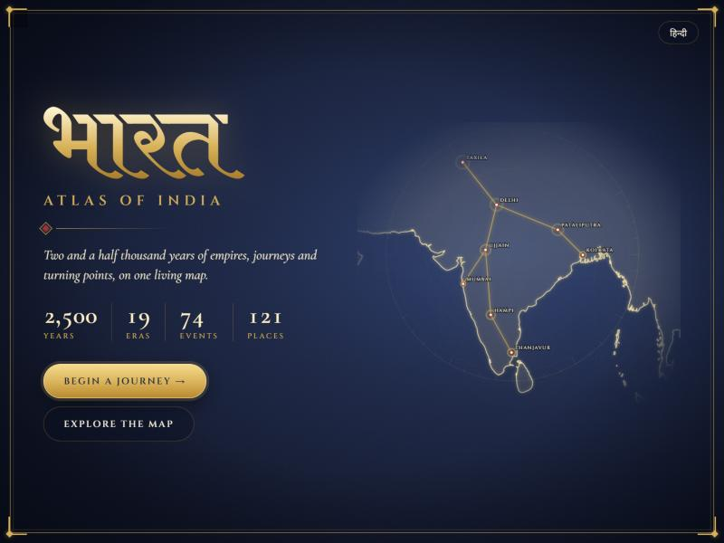
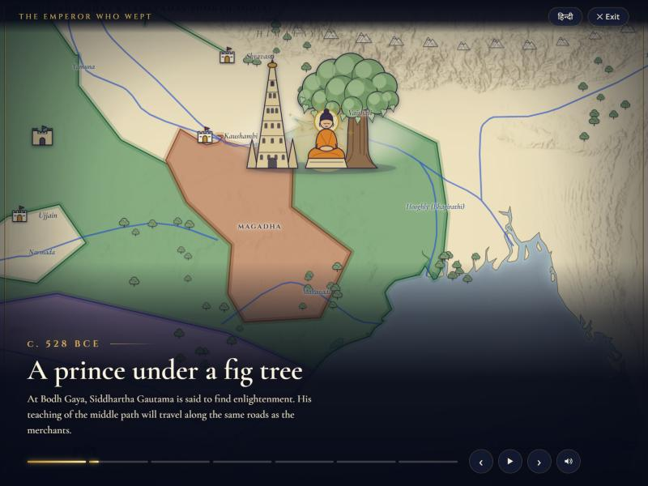
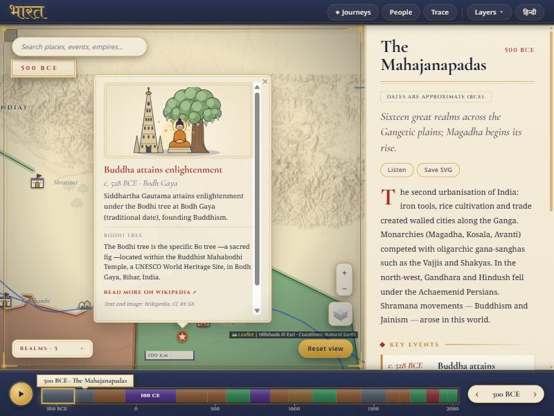

# Bharat Itihaas · भारत इतिहास

**An interactive historical atlas of India, 500 BCE to today.**

### ▶ Live: **[kaulvishesh.github.io/bharat-itihaas](https://kaulvishesh.github.io/bharat-itihaas/)**

[](https://github.com/kaulvishesh/bharat-itihaas/actions/workflows/pages.yml)
[](india-atlas/LICENSE)



Scrub through 2,500 years of Indian history on one map: **19 eras** from the Mahajanapadas to today, **74 events**,
**121 places**, animated travellers and armies, and everything in **English and Hindi**. It is a static site
(Leaflet + vanilla JS, no build step, no analytics); the app shell works offline once loaded, map tiles need a connection.

## Try these

| | |
|---|---|
| **Cinematic Journeys** (✦ in the header) | Five directed stories where the camera cuts and pushes in, the year rolls like a counter and a caption narrates. Start with [*The Emperor Who Wept*](https://kaulvishesh.github.io/bharat-itihaas/#journey=maurya). |
| **Then & Now** (Layers menu) | Drag a curtain across the map: the era on parchment on one side, today's satellite imagery, borders and cities on the other. |
| **Click anything** | Kingdoms open a realm card; events open an illustrated plate with the matching Wikipedia article; zoom in and forts, temples, markets, mountains and forests are drawn on the map. |
| **Trace a place** (📍) | Click any spot and see which realm held it in every era. |
| **Hindi** | The हिन्दी button switches the whole interface, captions and narration. |

<table>
  <tr>
    <td width="50%"><br><sub>A journey scene: the Bodhi tree, the Buddha and the Mahabodhi temple drawn on the map at Bodh Gaya.</sub></td>
    <td width="50%"><br><sub>Then &amp; Now: the Maurya Empire on parchment against today's satellite view.</sub></td>
  </tr>
  <tr>
    <td colspan="2"><br><sub>Events carry an engraved plate and the Wikipedia article about the incident itself.</sub></td>
  </tr>
</table>

## Run it locally

```bash
cd india-atlas
python -m http.server 8011
```

Then open <http://localhost:8011> (internet needed for Leaflet and the map tiles). Useful links: `#era=14&lang=hi`
opens an era in Hindi, `#journey=maurya` starts a journey, `?intro=0` skips the title sequence.

## Publish your own copy

The site is fully static. In **Settings → Pages**, set **Source: GitHub Actions**; the workflow in
[`.github/workflows/pages.yml`](.github/workflows/pages.yml) validates the data, rebuilds the topic pages and sitemap with
your real URL and publishes the `india-atlas/` folder.

## What is where

- [`india-atlas/`](india-atlas/): the app (open `index.html`). Full feature list, developer API, MCP server and build tools are in [`india-atlas/README.md`](india-atlas/README.md) and [`india-atlas/docs/API.md`](india-atlas/docs/API.md).
- [`scripts/`](scripts/): data validation, GeoJSON export, topic-page and narration builders.

## Data, credits and caveats

Boundaries, routes and the positions of places are **approximate and for illustration only**; they are not authoritative
and take no position on any border. Hindi text was drafted with machine assistance and the English narration is
synthesised speech.

Built on [historical-basemaps](https://github.com/aourednik/historical-basemaps) (boundaries, GPL-3.0),
[Natural Earth](https://www.naturalearthdata.com) (coastlines, public domain), [Leaflet](https://leafletjs.com),
Esri and OpenStreetMap tiles, Wikipedia (CC BY-SA), and [Kokoro-82M](https://huggingface.co/hexgrad/Kokoro-82M) (narration, Apache-2.0).
The design language follows [jiangshan-map](https://github.com/DeanChensj/jiangshan-map). Every source and its licence is listed in
[`india-atlas/NOTICE.md`](india-atlas/NOTICE.md).

Released under the **GNU General Public License v3.0**, see [`india-atlas/LICENSE`](india-atlas/LICENSE).
