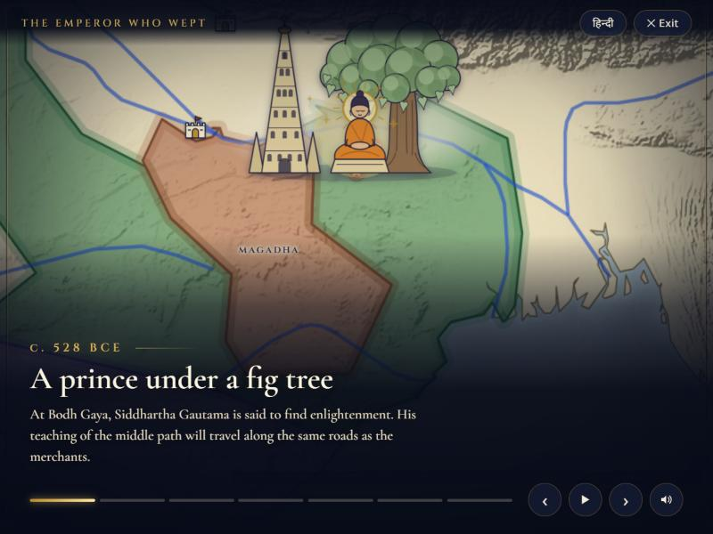
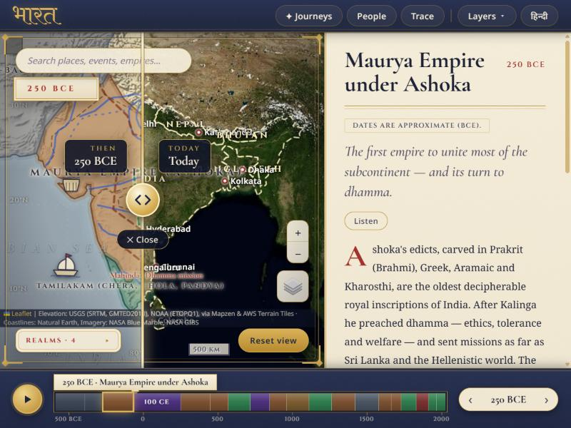
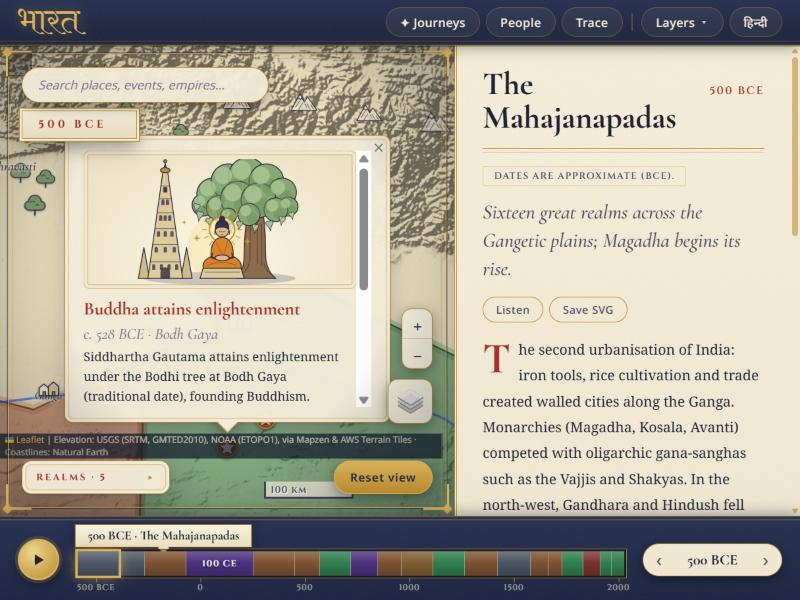

# Bharat Itihaas · भारत इतिहास

<p align="left"><strong>English</strong> · <a href="README_HI.md">हिन्दी</a> · <a href="CONTRIBUTING.md">Contributing</a></p>

**An interactive historical atlas of India, 500 BCE to today.**

### ▶ Live: **[kaulvishesh.github.io/bharat-itihaas](https://kaulvishesh.github.io/bharat-itihaas/)**

[](https://github.com/kaulvishesh/bharat-itihaas/actions/workflows/pages.yml)
[](https://github.com/kaulvishesh/bharat-itihaas/actions/workflows/ci.yml)
[](LICENSE)


Scrub through 2,500 years of Indian history on one map: **19 eras** from the Mahajanapadas to today, **74 events**,
**121 places**, animated travellers and armies, and everything in **English and Hindi**. It is a static site
(Leaflet + vanilla JS, no build step, no analytics); the app shell works offline once loaded, map tiles need a connection.

## Try these

| | |
|---|---|
| **Cinematic Journeys** (✦ in the header) | Five directed stories where the camera cuts and pushes in, the year rolls like a counter and a caption narrates. Start with [*The Emperor Who Wept*](https://kaulvishesh.github.io/bharat-itihaas/#journey=maurya). |
| **Then & Now** (Layers menu) | Drag a curtain across the map: the era on parchment on one side, today's satellite imagery, borders and cities on the other. |
| **Ambient music** (♪ in the header, or press M) | A soft tanpura drone with slow raga phrases that follow the era you are in, generated live in your browser (no audio files). Off until you switch it on; it dips under the narration. |
| **Click anything** | Kingdoms open a realm card; events open an illustrated plate with the matching Wikipedia article; zoom in and forts, temples, markets, mountains and forests are drawn on the map. |
| **Trace a place** (📍) | Click any spot and see which realm held it in every era. |
| **Hindi** | The हिन्दी button switches the whole interface, captions and narration. |

<table>
  <tr>
    <td width="50%"><br><sub>A journey scene: the Bodhi tree, the Buddha and the Mahabodhi temple drawn on the map at Bodh Gaya.</sub></td>
    <td width="50%"><br><sub>Then &amp; Now: the Maurya Empire on parchment against today's satellite view.</sub></td>
  </tr>
  <tr>
    <td colspan="2"><br><sub>Events carry an engraved plate and the Wikipedia article about the incident itself.</sub></td>
  </tr>
</table>

## Features

- **19 eras** (500 BCE → today) with simplified historical boundaries, a ghost outline of the previous era, and a proportional time rail.
- **Trace a place** (📍): click anywhere to see which realm covered that spot in every era, plus the events that happened near it, computed by point-in-polygon against the boundaries.
- **Person chronicles** (👤): Buddha, Ashoka, Xuanzang, Adi Shankara, Guru Nanak, Akbar, Shivaji and Gandhi, with animated routes, English/Hindi bios and a **compare** view (lifespans and overlap).
- **Opening title sequence**: the subcontinent is inked onto the page, trade roads light up, the numbers count up (once per session; `?intro=0` skips, `?intro=1` forces, click the भारत seal to replay).
- **Cinematic Journeys** (✦ in the header): five directed stories, *The Emperor Who Wept*, *Eyes on India*, *The Tamil Sea Empire*, *Sultans, Shahs & Emperors* and *The Road to Independence*. Each scene is a cinematic cut and slow push-in (never a fly-over, so realms are always fully drawn), the era changes underneath, the year rolls like a counter and a lower-third caption narrates. Key moments carry **illustrated landmarks** drawn on the map (the Bodhi tree with the seated Buddha and the Mahabodhi temple, Nalanda's brick monasteries, Ashoka's lion pillar, the Brihadisvara vimana, the Qutb Minar, the Taj Mahal, the Red Fort), which also appear as engraved plates in those events' popups. **Narration** (🔊) plays pre-rendered neural speech (Kokoro-82M) in English and the best voice installed on the device for Hindi. Pause to take the map in your own hands; ← → Space Esc work. Link straight to one with `#journey=maurya`.
- **Then & Now** (under Layers): drag a curtain across the map, the era on parchment on one side, today's satellite imagery with modern borders and cities on the other.
- **Ambient music** (♪ in the header, on the title screen and in the journey controls; press `M`): a tanpura-style drone, a slow pad and sparse bell phrases in a raga scale that follows the era (Bhoopali, Yaman, Bhairavi, Bhairav; each journey has its own), synthesised live with the Web Audio API (`js/music.js`, no audio files). Off by default, remembered once chosen, ducks under narration, pauses when the tab is hidden.
- **Full guided tour** (all 93 steps, from the Journeys menu), with optional **voice narration** (browser speech synthesis).
- **Animated journeys** (`js/routes.js`), **rivers** (`js/rivers.js`) and **roads, canals and dams that appear in their own period** (`js/works.js`: Uttarapatha, Grand Trunk Road, Western Yamuna Canal, Kallanai, Bhakra…).
- **Search** (press `/`), relief and satellite basemaps, a "locate it on the map" quiz, shareable links, full English/Hindi UI.
- **Territory chart** (📊, under ⋯): size of the largest mapped realm in every era (rough estimates), and **download any era as SVG** (⬇ in the info panel).
- **Installable and offline-capable** (PWA: the app shell and Leaflet are cached; map tiles still need a network). Respects `prefers-reduced-motion`.
- **Click a kingdom** for a realm card (notes, rough extent, places and events inside, neighbours, the same realm in other eras). **Zoom in** and the map fills with drawn forts, market towns, temples, stupas, mosques, harbours, mountain chains and forests.
- One hand-drawn pictogram set (`js/icons.js`) is used everywhere, including the travellers (rider, pilgrim, ship, lorry) that walk the routes.
- **Static topic pages** (`topics/`, English + Hindi, with inline SVG maps), `sitemap.xml` and `robots.txt` for search engines.
- **For developers:** `window.atlasAPI`, iframe embed (`?embed=1`) with `postMessage`, a zero-dependency **MCP server**, **GeoJSON/JSON export**, a **Python CLI** (`skills/atlas_cli.py`, includes SVG rendering), and Docker. See [`docs/API.md`](docs/API.md).

## Keyboard shortcuts and links

| | |
|---|---|
| `/` | Search places, events and realms |
| `←` `→` | Previous / next era |
| `M` | Ambient music on or off |
| `Esc` | Close a popup, the curtain or a journey |
| `#era=14&lang=hi` | Open an era (0 to 18) in Hindi |
| `#journey=maurya` | Start a journey (`maurya`, `travellers`, `chola`, `sultans`, `freedom`) |
| `?intro=0` | Skip the title sequence |

## Run it locally

```bash
git clone https://github.com/kaulvishesh/bharat-itihaas.git
cd bharat-itihaas
python -m http.server 8011
```

Then open <http://localhost:8011> (internet needed for Leaflet and the map tiles). Nothing else to install: there is no build step.

Docker (untested here): `docker compose up -d --build`, then open <http://localhost:8009>.

## Publish your own copy

The site is fully static (relative paths), so it works from a GitHub Pages sub-path. Fork or push this repository, then in **Settings → Pages** set **Source: GitHub Actions**. The workflow in [`.github/workflows/pages.yml`](.github/workflows/pages.yml) validates the data, rebuilds the topic pages and sitemap with your real URL, and publishes the runtime files (everything except `scripts/`, `assets/`, `.github/` and the project docs) to `https://<user>.github.io/<repo>/`. [`ci.yml`](.github/workflows/ci.yml) runs the checks on every push and pull request.

## Repository structure

```text
├── index.html                 # the app page (strict Content-Security-Policy, no build step)
├── sw.js · manifest.webmanifest · icon.svg   # offline app shell (PWA); bump ?v= in index.html and sw.js together
├── css/                       # style.css (design system), wow.css (intro, journeys, music, Then & Now), fonts.css
├── fonts/                     # self-hosted fonts with their licence texts (SIL OFL)
├── js/
│   ├── data.js · data_hi.js   # eras, places, events; Hindi aligned with English by index
│   ├── geo.js · land.js       # generated: historical boundaries and the coastline (see scripts/)
│   ├── core.js                # shared geometry/lookup helpers (browser and Node tools)
│   ├── app.js · extras.js     # the app: map, timeline, panels, trace, people, API
│   ├── routes.js · rivers.js · works.js · people.js · battles.js · detail.js · realm_notes.js · event_wiki.js   # map content
│   ├── lod.js · declutter.js · icons.js · landmarks.js   # drawn places, label collision, the pictogram and landmark art
│   ├── journeys_data.js · journeys.js · voice.js · music.js   # cinematic journeys, narration, ambient music
│   ├── intro.js · preintro.js · swipe.js   # title sequence, Then & Now curtain
│   ├── terrain.js · wiki.js   # hillshade/relief/satellite surfaces, Wikipedia summaries
│   └── sw-register.js
├── audio/                     # pre-rendered journey narration (Kokoro-82M) + manifest.json
├── data/ · geojson/ · topics/ # generated exports and static topic pages (see Build tools)
├── docs/API.md                # developer API, embed, MCP
├── skills/atlas_cli.py        # Python CLI (JSON lookup, SVG rendering)
├── scripts/                   # validation, exports, topic pages, narration and data builders
├── assets/                    # README screenshots (not part of the deployed site)
├── NOTICE.md · LICENSE        # every source and its licence · GPL-3.0
├── Dockerfile · docker-compose.yml
└── .github/                   # Pages deploy, CI checks, data-correction issue form
```

## Data, credits and caveats

- Boundaries come from [aourednik/historical-basemaps](https://github.com/aourednik/historical-basemaps) (GPL-3.0), snapshot years 500 BCE … 2010, filtered to South Asia and simplified by `scripts/build_geo.py` into `js/geo.js`. Each era names the snapshot it uses; snapshots are not always the era's exact year. The Maratha heartland at 1700 is a hand-drawn sketch (dashed).
- Boundaries, routes and the positions of places are **approximate and for illustration only**; they are not authoritative and are not the Survey of India's official map. Present-day India (the 1960 and 2010 eras) is drawn as India officially shows itself, including all of Jammu & Kashmir and Ladakh, from Natural Earth's "India point of view" (`scripts/apply_india_claim.js`). That is an approximation, not the Survey of India's file; other outlines are as the data sources draw them.
- Source names/polygons can be generic ("Hindu kingdoms"); some were relabelled by hand. Journey paths in `js/routes.js` are schematic polylines through known waypoints, not surveyed routes.
- Hindi covers the whole interface, era and realm names, narratives, rulers, places, events and quiz clues. Hindi text was drafted with machine assistance and has not been reviewed by a native-speaker editor; the English narration is synthesised speech.
- Map surfaces are open and keyless: the hillshade and Relief view are drawn in the browser from AWS Terrain Tiles (USGS/NOAA elevation, `js/terrain.js`); Satellite and the "today" side of Then & Now are NASA Blue Marble (500 m, so close zooms are soft). Both services are fine for light traffic; for heavy traffic host your own copy.

Built on [historical-basemaps](https://github.com/aourednik/historical-basemaps) (boundaries, GPL-3.0),
[Natural Earth](https://www.naturalearthdata.com) (coastlines, public domain), [Leaflet](https://leafletjs.com),
public elevation data (USGS and NOAA, via AWS Terrain Tiles), NASA Blue Marble imagery, Wikipedia (CC BY-SA), and [Kokoro-82M](https://huggingface.co/hexgrad/Kokoro-82M) (narration, Apache-2.0).
The design language follows [jiangshan-map](https://github.com/DeanChensj/jiangshan-map). Every source and its licence is listed in [`NOTICE.md`](NOTICE.md).

## Build tools

All optional; the outputs are already committed.

```bash
node scripts/validate.js            # data integrity checks (Hindi coverage, coordinates, sorting, ...)
node scripts/export_geojson.js      # geojson/ (one file per era)
node scripts/export_data.js         # data/atlas.json (for the Python CLI)
node scripts/build_topics.js --base https://YOUR-HOST/path/   # topics/, sitemap.xml, robots.txt
node scripts/test_mcp.js            # MCP server smoke test
NARRATION_MODULES=/path/to/tools node scripts/make_narration.js   # re-render the Journeys' English narration clips (audio/); see the header of that file
python -I scripts/build_geo.py <raw_dir> js/geo.js    # rebuild boundaries from the raw GeoJSON (then run scripts/apply_india_claim.js)
python skills/atlas_cli.py render 4 -o gupta.svg
```

After editing `js/data.js`, run `validate.js`, then the first three exports so the static outputs stay in sync. If you edit a Journey caption (`js/journeys_data.js`) re-run `make_narration.js`; until then that caption falls back to the browser voice. When you change any JS/CSS, bump the `?v=` number in `index.html` **and** `sw.js` together so the service worker refreshes. See [CONTRIBUTING.md](CONTRIBUTING.md).

Released under the **GNU General Public License v3.0**, see [`LICENSE`](LICENSE).
