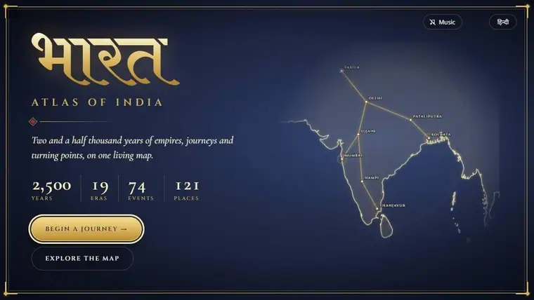
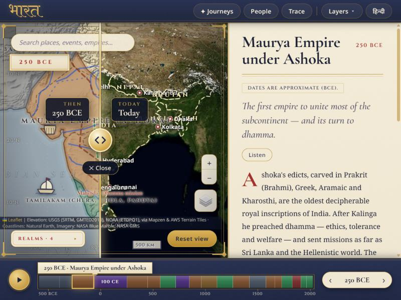
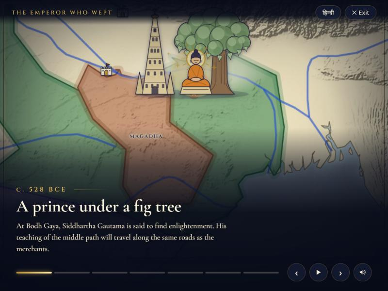
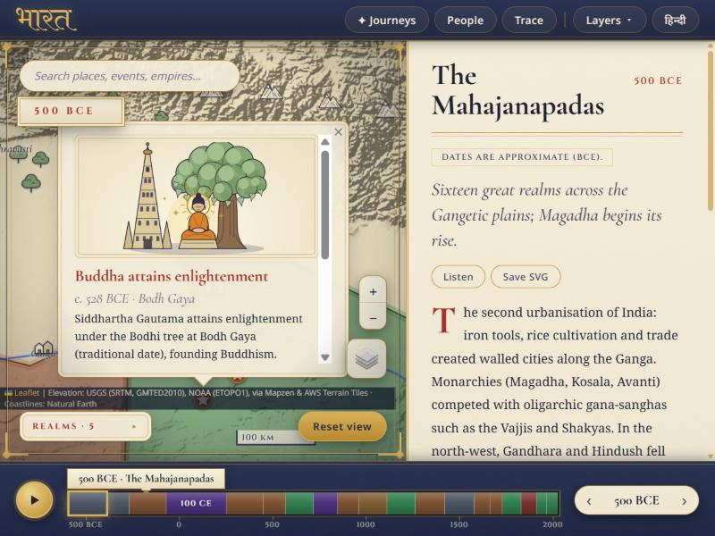

# भारत इतिहास · Bharat Itihaas

<p align="left">
  <a href="README.md">English</a> · <strong>हिन्दी</strong> · <a href="CONTRIBUTING.md">योगदान (English)</a>
</p>

**महाजनपदों (500 ई.पू.) से आज तक भारत का इंटरैक्टिव ऐतिहासिक मानचित्र: समय में आगे-पीछे चलें, सिनेमाई यात्रा देखें और इतिहास के पदचिह्नों पर चलें**

[**लाइव डेमो देखें → https://kaulvishesh.github.io/bharat-itihaas/**](https://kaulvishesh.github.io/bharat-itihaas/#lang=hi) · [Open in English](https://kaulvishesh.github.io/bharat-itihaas/)

[](https://github.com/kaulvishesh/bharat-itihaas/actions/workflows/pages.yml)
[](https://github.com/kaulvishesh/bharat-itihaas/actions/workflows/ci.yml)
[](LICENSE)

> **श्रेय उसे, जिसका है:** भारत इतिहास **[Chronicles of the Realm · 江山时序 (jiangshan-map)](https://github.com/DeanChensj/jiangshan-map)** से प्रेरित है और उसी की डिज़ाइन-भाषा पर बना है। इसे **[DeanChensj](https://github.com/DeanChensj)** ने बनाया है, जो चीन का एक इंटरैक्टिव ऐतिहासिक मानचित्र है। मूल परियोजना को स्टार ज़रूर दें। देखें [आभार](#आभार)।

<p align="center">
  <a href="https://kaulvishesh.github.io/bharat-itihaas/#lang=hi">
    
  </a>
</p>

---

## घूमकर देखना मज़ेदार क्यों है

भारत का इतिहास पढ़ते हुए क्या आपने कभी सोचा है:
- *"बोधगया, नालंदा और पाटलिपुत्र ठीक कहाँ हैं, और मगध का केंद्र रेशम मार्ग पर बसे तक्षशिला से कितना दूर था?"*
- *"मौर्य, गुप्त, चोल और मुग़ल, हर किसी के शिखर पर उसके पास असल में कितना भूभाग था, और पड़ोस में कौन था?"*
- *"सोलह महाजनपदों से अशोक के साम्राज्य, त्रिपक्षीय संघर्ष, चोल समुद्री साम्राज्य, दिल्ली सल्तनत, विजयनगर और मुग़लों से होते हुए कंपनी, राज, विभाजन और गणराज्य तक नक़्शा कैसे बदला?"*

**भारत इतिहास** ढाई हज़ार वर्षों के इतिहास को **19 युगों** में एक ही उत्कीर्ण चर्मपत्र-शैली के नक़्शे पर लाता है: **सरलीकृत ऐतिहासिक सीमाएँ** (पिछले युग की धुँधली रूपरेखा सहित), **74 घटनाएँ**, **121 स्थान**, **चलते-फिरते यात्री और सेनाएँ**, **पाँच सिनेमाई यात्राएँ**, **व्यक्ति-वृत्त** और **हल्का पृष्ठभूमि संगीत**, सब कुछ **हिन्दी और अंग्रेज़ी** में। भारी छपे एटलस की ज़रूरत नहीं: समय-पट्टी खींचें, किसी भी जगह पर क्लिक करें, या बस किसी यात्रा पर "चलाएँ" दबाएँ।

यह एक स्थिर (static) साइट है (Leaflet और सादा JavaScript, कोई बिल्ड नहीं, कोई एनालिटिक्स नहीं)। एक बार खुलने के बाद इसका ढाँचा ऑफ़लाइन चलता है; नक़्शे की टाइलों के लिए इंटरनेट चाहिए।

---

### विशेषता 1: समय-पट्टी खींचें, साम्राज्यों का उत्थान-पतन देखें और "तब" की "अब" से तुलना करें

- **19 युग, एक ही कैनवास पर**: महाजनपदों (500 ई.पू.) से मौर्य, कुषाण-सातवाहन, गुप्त, हर्ष-चालुक्य-पल्लव, त्रिपक्षीय संघर्ष, चोल, दिल्ली सल्तनत, विजयनगर और दक्कन सल्तनतें, मुग़ल, मराठा, कंपनी और राज, और फिर स्वतंत्रता व आज के दक्षिण एशिया तक। नीचे की अनुपातिक समय-पट्टी हर युग के सबसे बड़े राज्य के रंग में बँटी है।
- **पिछले युग की धुँधली सीमा**: हर युग के साथ पिछले युग की रूपरेखा हल्की छाया में दिखती है, ताकि लाभ और हानि तुरंत दिखें। किसी राज्य पर क्लिक करें तो उसका परिचय-कार्ड खुलता है।
- **नदियाँ, सड़कें, नहरें और बाँध अपने काल में**: उत्तरापथ, ग्रैंड ट्रंक रोड, पश्चिमी यमुना नहर, कल्लनै, भाखड़ा आदि तभी दिखते हैं जब वे अस्तित्व में थे।
- **ज़ूम करते ही नक़्शा भरता है**: क़िले, बाज़ार-नगर, मंदिर, स्तूप, मस्जिदें, बंदरगाह, पर्वतमालाएँ और वन, सब एक ही हाथ से बने चित्र-समूह में।
- **तब और अब का पर्दा**: **परतें** मेनू में नक़्शे पर पर्दा खींचें: एक ओर चुना हुआ युग चर्मपत्र पर, दूसरी ओर आज की उपग्रह तस्वीर, आधुनिक सीमाएँ और शहर।
- **तीन आधार-नक़्शे**: उत्कीर्ण **पुराना एटलस** (डिफ़ॉल्ट), **राहत** और **उपग्रह**, सब खुले आँकड़ों से।

> [लाइव आज़माएँ: अशोक के अधीन मौर्य साम्राज्य (250 ई.पू.) →](https://kaulvishesh.github.io/bharat-itihaas/#era=2&lang=hi)



---

### विशेषता 2: सिनेमाई यात्राएँ, पाँच निर्देशित कहानियाँ

हेडर में **✦ यात्राएँ** दबाएँ (या नीचे का लिंक खोलें)। नक़्शा पूरी स्क्रीन ले लेता है; हर दृश्य एक सिनेमाई कट और धीमी ज़ूम-इन है (कभी उड़ान नहीं, ताकि राज्य हमेशा पूरे बने दिखें), नीचे युग बदलता है, वर्ष काउंटर की तरह घूमता है और कैप्शन कथा सुनाता है:

| यात्रा | लिंक |
| :--- | :--- |
| *वह सम्राट जो रोया* (500 → 250 ई.पू.) | [`#journey=maurya`](https://kaulvishesh.github.io/bharat-itihaas/#journey=maurya&lang=hi) |
| *भारत पर नज़र* (यात्रियों के विवरण) | [`#journey=travellers`](https://kaulvishesh.github.io/bharat-itihaas/#journey=travellers&lang=hi) |
| *तमिल समुद्री साम्राज्य* | [`#journey=chola`](https://kaulvishesh.github.io/bharat-itihaas/#journey=chola&lang=hi) |
| *सुल्तान, शाह और बादशाह* | [`#journey=sultans`](https://kaulvishesh.github.io/bharat-itihaas/#journey=sultans&lang=hi) |
| *आज़ादी की राह* | [`#journey=freedom`](https://kaulvishesh.github.io/bharat-itihaas/#journey=freedom&lang=hi) |

- **नक़्शे पर बने चित्रात्मक स्थल-चिह्न**: बोधिवृक्ष और ध्यानमग्न बुद्ध के साथ महाबोधि मंदिर, नालंदा के ईंटों के विहार, अशोक-स्तंभ, बृहदीश्वर का विमान, क़ुतुब मीनार, ताजमहल और लाल क़िला। ये उन घटनाओं के पॉपअप में उत्कीर्ण चित्र-पट्टिका के रूप में भी दिखते हैं।
- **कथन** (🔊): अंग्रेज़ी में पहले से तैयार न्यूरल आवाज़ ([Kokoro-82M](https://huggingface.co/hexgrad/Kokoro-82M)); हिन्दी में आपके उपकरण की सबसे अच्छी आवाज़।
- **पृष्ठभूमि संगीत** (♪, या `M` दबाएँ): तानपुरे जैसी गूँज और धीमे राग-स्वर, जो युग के साथ बदलते हैं (भूपाली, यमन, भैरवी, भैरव; हर यात्रा का अपना राग), जो Web Audio API से आपके ब्राउज़र में ही बनते हैं, कोई ऑडियो फ़ाइल नहीं। जब तक आप चालू न करें, बंद रहता है; चुनाव याद रखा जाता है; कथन के समय धीमा होता है; टैब छिपने पर रुक जाता है।
- **साझा करें**: हर यात्रा के अंतिम कार्ड पर साझा करने का बटन है (फ़ोन पर शेयर-शीट खुलती है, कंप्यूटर पर लिंक कॉपी होता है); **परतें → साझा करें** मौजूदा दृश्य का लिंक कॉपी करता है। साझा किए लिंक WhatsApp, X, Reddit, LinkedIn और Slack पर पूर्वावलोकन-कार्ड के साथ दिखते हैं।
- **नक़्शा कभी भी अपने हाथ में लें**: रोककर खींचें और ज़ूम करें; `←` `→` `Space` `Esc` काम करते हैं। यात्राएँ मेनू में सभी 93 चरणों की **पूरी निर्देशित यात्रा** भी है।

> [लाइव आज़माएँ: वह सम्राट जो रोया →](https://kaulvishesh.github.io/bharat-itihaas/#journey=maurya&lang=hi)



---

### विशेषता 3: किसी भी स्थान या घटना पर क्लिक करें (`स्थान खोजें`)

नक़्शे पर **किसी भी चीज़ पर क्लिक करें**, या **स्थान खोजें** (📍) दबाकर कोई भी बिंदु चुनें:
- **हर युग में वह जगह किसके पास थी**: कार्ड उस बिंदु को ढकने वाले राज्य को सभी 19 युगों में गिनाता है, साथ में आसपास की घटनाएँ, सीमाओं के विरुद्ध बिंदु-बहुभुज गणना से।
- **उत्कीर्ण चित्र-पट्टिका और विकिपीडिया लेख वाली घटनाएँ**: घटना का पॉपअप चित्र-पट्टिका (बुद्ध के ज्ञान-प्राप्ति के लिए बोधिवृक्ष, अशोक-स्तंभों के लिए सिंह-शीर्ष...) और उसी घटना पर विकिपीडिया का लेख दिखाता है, जो उसी समय लाया जाता है (CC BY-SA, श्रेय दिखाया जाता है)।
- **खोज** (`/`): दोनों भाषाओं में स्थान, घटनाएँ, राज्य, यात्राएँ और व्यक्ति खोजें।

> [लाइव आज़माएँ: गुप्त युग में पाटलिपुत्र (25.61°उ 85.14°पू) →](https://kaulvishesh.github.io/bharat-itihaas/?trace=25.61,85.14#era=4&lang=hi)



---

### विशेषता 4: व्यक्ति-वृत्त और नक़्शा-क्विज़

**व्यक्ति** (👤) दबाकर बदलती सीमाओं के बीच आठ जीवन-यात्राएँ देखें: चलते हुए मार्ग, हिन्दी-अंग्रेज़ी जीवनी और जीवनकाल व उनके ओवरलैप का **तुलना** दृश्य:

| व्यक्ति | लिंक |
| :--- | :--- |
| गौतम बुद्ध | [`?person=buddha`](https://kaulvishesh.github.io/bharat-itihaas/?person=buddha#lang=hi) |
| अशोक | [`?person=ashoka`](https://kaulvishesh.github.io/bharat-itihaas/?person=ashoka#lang=hi) |
| ह्वेनसांग | [`?person=xuanzang`](https://kaulvishesh.github.io/bharat-itihaas/?person=xuanzang#lang=hi) |
| आदि शंकराचार्य | [`?person=shankara`](https://kaulvishesh.github.io/bharat-itihaas/?person=shankara#lang=hi) |
| गुरु नानक | [`?person=nanak`](https://kaulvishesh.github.io/bharat-itihaas/?person=nanak#lang=hi) |
| अकबर | [`?person=akbar`](https://kaulvishesh.github.io/bharat-itihaas/?person=akbar#lang=hi) |
| शिवाजी | [`?person=shivaji`](https://kaulvishesh.github.io/bharat-itihaas/?person=shivaji#lang=hi) |
| मोहनदास क. गांधी | [`?person=gandhi`](https://kaulvishesh.github.io/bharat-itihaas/?person=gandhi#lang=hi) |

क्या आपको नक़्शा याद है? **परतें → क्विज़** में "नक़्शे पर ढूँढें" चुनौती खोलें।

---

## कीबोर्ड और साझा करने योग्य लिंक

### कीबोर्ड

| कुंजी / क्रिया | प्रभाव |
| :--- | :--- |
| **`/`** | खोज-बॉक्स पर जाएँ: स्थान, घटनाएँ, राज्य, यात्राएँ, व्यक्ति |
| **`←` / `→`** या नीचे **`‹ / ›`** | पिछला / अगला युग (यात्रा के भीतर: पिछला / अगला दृश्य) |
| **`Space`** | यात्रा रोकें या चलाएँ |
| **`M`** | पृष्ठभूमि संगीत चालू / बंद |
| **`Esc`** | पॉपअप, तब-और-अब का पर्दा या यात्रा बंद करें |
| **भारत मुहर पर क्लिक** | शुरुआती शीर्षक दृश्य फिर से देखें |

### साझा करने योग्य लिंक

पता-पट्टी में युग और भाषा दिखती रहती है। किसी भी क्षण को साझा करने के लिए पैरामीटर जोड़ें:
- **युग खोलें** (0 से 18): `#era=2` (अशोक के अधीन मौर्य) / `#era=4` (गुप्त) / `#era=9` (चोल साम्राज्य अपने शिखर पर) / `#era=14` (सबसे बड़ा मुग़ल साम्राज्य) / `#era=17` (स्वतंत्रता और गणराज्य)
- **भाषा बदलें**: `#lang=en` (English) / `#lang=hi` (हिन्दी), जैसे `#era=14&lang=hi`
- **यात्रा शुरू करें**: `#journey=maurya`, `travellers`, `chola`, `sultans` या `freedom`
- **किसी का व्यक्ति-वृत्त खोलें**: `?person=akbar`
- **बिंदु खोजें**: `?trace=28.61,77.21` (दिल्ली)
- **पूरी निर्देशित यात्रा शुरू करें**: `?tour=1`
- **शीर्षक दृश्य छोड़ें या ज़बरदस्ती दिखाएँ**: `?intro=0` / `?intro=1`

### अपने पृष्ठ में एम्बेड करें

नक़्शे का कोई भी दृश्य अपने ब्लॉग या कोर्स-साइट में रखें: URL में `embed=1` जोड़ें और `<iframe>` में चिपकाएँ:

```html
<iframe
  src="https://kaulvishesh.github.io/bharat-itihaas/?embed=1&person=akbar#lang=hi"
  width="100%" height="520" loading="lazy" style="border:0"
  title="भारत इतिहास · अकबर"></iframe>
```

एम्बेड किए गए नक़्शे में टूलबार और जानकारी-पैनल छिपे रहते हैं। पैरामीटर और `postMessage` से नियंत्रण का तरीक़ा [English README](README.md#embed-in-your-page) और [`docs/API.md`](docs/API.md) में है।

---

## AI एजेंट, MCP और LLM एकीकरण

**भारत इतिहास** LLM, MCP क्लाइंट और AI एजेंटों के लिए ऐतिहासिक-भूगोल इंजन की तरह भी चलता है: उन्हें निर्देशांक अंदाज़ने नहीं पड़ते; वे किसी युग, राज्य, व्यक्ति या नक़्शे के बिंदु के बारे में पूछ सकते हैं।

- **मशीन-पठनीय विनिर्देश**: [`llms.txt`](llms.txt)
- **शून्य-निर्भरता स्थानीय MCP सर्वर (`stdio`)**: [`scripts/mcp_server.js`](scripts/mcp_server.js), 7 ऑफ़लाइन टूल: `list_eras`, `get_era`, `search`, `trace_place`, `list_people`, `get_person`, `compare_people`।
  ```json
  {
    "mcpServers": {
      "bharat-itihaas": {
        "command": "node",
        "args": ["/absolute/path/to/bharat-itihaas/scripts/mcp_server.js"]
      }
    }
  }
  ```
- **Python CLI** (केवल मानक लाइब्रेरी): `python skills/atlas_cli.py eras | era 400 | search nalanda | trace 25.61 85.14 | person akbar | render 4 -o gupta.svg --lang hi`
- **ब्राउज़र API** `window.atlasAPI`: पूरी सूची [`docs/API.md`](docs/API.md) में।

---

## अपने कंप्यूटर पर चलाएँ

कोई निर्भरता या बिल्ड चरण नहीं। क्लोन करें और किसी भी स्थिर HTTP सर्वर से चलाएँ:

```bash
git clone https://github.com/kaulvishesh/bharat-itihaas.git
cd bharat-itihaas
python -m http.server 8011
```

फिर ब्राउज़र में `http://localhost:8011` खोलें (Leaflet और नक़्शे की टाइलों के लिए इंटरनेट चाहिए)।

**Docker से** (लेखक ने यह सेटअप जाँचा नहीं है): `docker compose up -d --build`, फिर `http://localhost:8009` खोलें।

## अपनी प्रति प्रकाशित करें

साइट पूरी तरह स्थिर है, इसलिए GitHub Pages के उप-पथ पर चलती है। रिपॉज़िटरी को फ़ोर्क करें या अपने खाते में पुश करें, फिर **Settings → Pages** में **Source: GitHub Actions** चुनें। [`pages.yml`](.github/workflows/pages.yml) डेटा जाँचता है, आपके असली URL के साथ विषय-पृष्ठ और साइटमैप बनाता है और रनटाइम फ़ाइलें प्रकाशित करता है। [`ci.yml`](.github/workflows/ci.yml) हर पुश और पुल रिक्वेस्ट पर जाँच चलाता है।

## GeoJSON और डेटा निर्यात

```bash
node scripts/export_geojson.js      # geojson/: हर युग की एक GeoJSON फ़ाइल + index.json
node scripts/export_data.js         # data/atlas.json: गैर-JS टूल के लिए
```

सीमाएँ सरलीकृत अनुमान हैं, सर्वेक्षित नहीं। रिपॉज़िटरी की बनावट और बिल्ड-टूल के लिए [English README](README.md#repository-structure) और [CONTRIBUTING.md](CONTRIBUTING.md) देखें।

---

## आभार

**[Chronicles of the Realm · 江山时序 (jiangshan-map)](https://github.com/DeanChensj/jiangshan-map)**, जिसे **[DeanChensj](https://github.com/DeanChensj)** ने बनाया है ([लाइव डेमो](https://deanchen.me/jiangshan-map/?lang=en)), वह परियोजना है जिससे यह एटलस उपजा है। भारत इतिहास का विचार और उसका ढाँचा उन्हीं का है, और इसका श्रेय मूल रचयिता को जाता है। हमने उनसे लिया:

- **दृश्य-ढाँचा**: चर्मपत्र जैसा गर्म रंग-पटल और सिंदूरी उभार, जुड़ा हुआ जानकारी-पैनल और खींचने योग्य खंडित समय-पट्टी।
- **भारत के लिए ढाले गए विचार**: स्थान को युगों में खोजना, व्यक्ति-वृत्त, नक़्शा-क्विज़, साझा करने योग्य लिंक, iframe एम्बेड और AI-एजेंट एकीकरण (`llms.txt`, MCP सर्वर, CLI और ब्राउज़र API)।
- **रिपॉज़िटरी का ढाँचा और इस README की बनावट।**

भारत का डेटा, हिन्दी-अंग्रेज़ी सामग्री, सिनेमाई यात्राएँ, संगीत और उनका कोड इस परियोजना के लिए अलग से लिखे गए हैं, और पूरी रिपॉज़िटरी मूल की तरह ही GPL-3.0 के अंतर्गत है। चीन का इंटरैक्टिव एटलस चाहिए तो उनका वाला इस्तेमाल करें।

---

## डेटा-स्रोत और लाइसेंस

कोड और इस परियोजना द्वारा बनाया गया डेटा **GPL-3.0** के अंतर्गत है। हर स्रोत और उसका लाइसेंस [`NOTICE.md`](NOTICE.md) में है:

| परत | स्रोत | लाइसेंस |
| :-- | :-- | :-- |
| कोड | यह परियोजना | GPL-3.0 |
| ऐतिहासिक सीमाएँ | [aourednik/historical-basemaps](https://github.com/aourednik/historical-basemaps) से सरलीकृत, हाथ से संपादित | GPL-3.0 |
| वर्तमान भारत (1960 और 2010 के युग) | [Natural Earth](https://www.naturalearthdata.com) 10m देशों ("भारत का दृष्टिकोण") से `scripts/apply_india_claim.js` द्वारा | सार्वजनिक डोमेन |
| तटरेखा | Natural Earth 50m | सार्वजनिक डोमेन |
| युग, स्थान, घटनाएँ, मार्ग, व्यक्ति, यात्राएँ, हिन्दी पाठ, चित्र, संगीत | इस परियोजना ने बनाए | GPL-3.0 |
| अंग्रेज़ी कथन (`audio/en/`) | [Kokoro-82M](https://huggingface.co/hexgrad/Kokoro-82M) से बना, कृत्रिम आवाज़ | Apache-2.0 |
| छायांकन और राहत-नक़्शा | [AWS Terrain Tiles](https://registry.opendata.aws/terrain-tiles/) (USGS का SRTM, GMTED2010; NOAA का ETOPO1) से ब्राउज़र में | सार्वजनिक डोमेन |
| उपग्रह दृश्य | [NASA Blue Marble](https://visibleearth.nasa.gov/collection/1484/blue-marble), NASA GIBS के ज़रिए | NASA डेटा, कोई प्रतिबंध नहीं |
| नक़्शा इंजन | [Leaflet](https://leafletjs.com) 1.9.4 | BSD-2-Clause |
| घटनाओं के चित्र और सार | विकिपीडिया, पॉपअप खुलने पर | CC BY-SA 4.0 |
| फ़ॉन्ट | Cormorant Garamond, Cinzel, Noto Serif/Sans, Amita (साइट के साथ) | SIL Open Font License 1.1 |
| डिज़ाइन की भाषा और रिपॉज़िटरी का ढाँचा | [jiangshan-map](https://github.com/DeanChensj/jiangshan-map), [DeanChensj](https://github.com/DeanChensj) द्वारा | GPL-3.0, Copyright © 2026 DeanChensj |

**अनुमानित सीमाएँ।** सीमाएँ, मार्ग, नदियाँ और स्थानों की स्थिति **अनुमानित हैं और केवल चित्रण के लिए**; ये प्रामाणिक नहीं हैं और भारतीय सर्वेक्षण विभाग (Survey of India) का आधिकारिक नक़्शा नहीं हैं। वर्तमान भारत उसी रूप में दिखाया गया है जैसा भारत स्वयं को आधिकारिक रूप से दर्शाता है, जिसमें पूरा जम्मू-कश्मीर और लद्दाख शामिल है; यह एक अनुमान है, आधिकारिक फ़ाइल नहीं।

**हिन्दी और कथन।** हिन्दी पाठ मशीन की सहायता से तैयार किया गया है और किसी मूल-भाषी संपादक ने उसकी समीक्षा नहीं की है; सुधार का स्वागत है। अंग्रेज़ी कथन कृत्रिम (synthesised) आवाज़ है।

**गोपनीयता।** कोई एनालिटिक्स, कुकी या ट्रैकिंग नहीं। फ़ॉन्ट साइट के साथ ही आते हैं।

**योगदान**: [CONTRIBUTING.md](CONTRIBUTING.md) देखें। **डेटा की ग़लती बताएँ**: कोई ग़लत वर्ष, स्थान या विवरण दिखा? [डेटा-सुधार का अनुरोध खोलें](https://github.com/kaulvishesh/bharat-itihaas/issues/new?template=data-error.yml) और हो सके तो स्रोत दें।

**GNU General Public License v3.0** के अंतर्गत जारी, देखें [`LICENSE`](LICENSE)।
